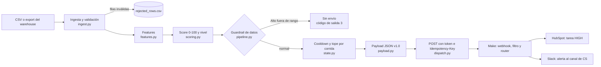

# Arquitectura

## Flujo

## Etapas

| Etapa | Módulo | Entrada | Salida |
|---|---|---|---|
| Ingesta | `ingest.py` | CSV leído como texto | DataFrame con tipos convertidos y filas en cuarentena |
| Features | `features.py` | DataFrame válido | Días sin login, variación de uso, días a la renovación |
| Scoring | `scoring.py` | Features | Componentes 0-100, score, nivel y MRR en riesgo |
| Selección | `pipeline.py`, `state.py` | Clientes puntuados | Alertas elegidas según nivel mínimo, cooldown y tope |
| Payload | `payload.py` | Fila puntuada | JSON v1.0 con causas del score y textos de la acción |
| Envío | `dispatch.py` | Payload | Resultado por alerta: enviada o fallida |
| Reporte | `reporting.py`, `cli.py` | Resumen de la corrida | Tabla de consola y código de salida |

## Decisiones de diseño

Un score que se puede explicar. Sin cancelaciones históricas etiquetadas, un modelo supervisado no tiene de dónde aprender. La suma ponderada con rampas lineales es transparente: cada alerta lleva las señales que la causaron (`risk.drivers`) y los pesos están en un TOML versionado. `Scorer` es una interfaz de un solo método, así que un modelo con `predict_proba` puede reemplazar a `WeightedRuleScorer` sin tocar la ingesta ni el envío.

Python decide y Make enruta. El escenario tiene un webhook, un filtro, un router y dos acciones. Umbrales, textos, plazos y prioridades salen del payload. La lógica queda en Git y con pruebas, y cambiar un umbral no obliga a editar el escenario.

Tiempo inyectado. `as_of` entra como parámetro y ninguna función llama a `now()`. Una corrida se puede reproducir y probar con una fecha fija.

Idempotencia y fatiga de alertas. `event_id` es un hash de cliente, día y nivel. Viaja en el payload y en la cabecera `Idempotency-Key`, de modo que el receptor puede reconocer un reintento. Aparte, el estado en SQLite aplica un cooldown: un cliente no recibe otra alerta dentro de la ventana salvo que suba de nivel o su score crezca `escalation_delta` puntos desde la última enviada. Los envíos fallidos no cuentan para el cooldown, así que se reintentan en la corrida siguiente.

Cuarentena en lugar de abortar. Una fila rota no debería impedir que se avise de las demás. Las filas inválidas van a `rejected_rows.csv` con el valor original y el motivo. La corrida solo falla si ninguna fila es válida.

Guardrail contra datos rotos. Si la fuente deja de actualizar los logins, todas las cuentas parecen inactivas y Customer Success recibiría una avalancha de falsas alarmas. Con al menos `min_rows` filas válidas, si más de `max_alto_ratio` de las cuentas sale en Alto, no se envía nada y el proceso termina con código 3. `--force` lo omite cuando el resultado es correcto.

Secretos fuera del código. URL y token salen del entorno o de un `.env` ignorado por Git. El cliente exige https (salvo en localhost) y nunca registra la URL completa, porque la ruta del webhook funciona como secreto.

Autenticación hacia Make. El control práctico es un token en cabecera que el escenario valida con un filtro, más la URL secreta y, si la IP de salida es fija, la restricción de IP del webhook. Con un receptor propio convendría firmar el cuerpo con HMAC-SHA256.

## Modos de falla

| Situación | Comportamiento |
|---|---|
| Faltan columnas obligatorias en el CSV | Error claro y código de salida 1 |
| Algunas filas inválidas | Cuarentena en `rejected_rows.csv` y el resto continúa |
| Todas las filas inválidas | Error y código de salida 1 |
| Configuración inválida (por ejemplo, pesos que no suman 1) | Error al iniciar, antes de leer datos |
| Make responde 5xx o 429, o hay timeout | Reintentos con backoff exponencial, respetando `Retry-After`. Si se agotan, la alerta queda fallida y el código de salida es 2 |
| Fallan 3 envíos seguidos | Se corta el circuito: no se intenta el resto de la corrida, que queda marcado como fallido y sin registro de estado. Evita minutos de reintentos contra un destino caído. El código de salida es 2 |
| Make responde 4xx distinto de 408, 425 y 429 | Falla sin reintentos: reintentar no corrige una URL o un token incorrectos |
| Demasiadas cuentas en Alto | Guardrail: no se envía nada y el código de salida es 3 |
| Corrida repetida | El cooldown suprime los duplicados |
| El proceso muere entre el POST y el registro del estado | La alerta puede reenviarse en la corrida siguiente. Conserva el mismo `event_id` si es el mismo día y nivel, y el receptor puede descartarla |

## Qué cambiaría al escalar

| Necesidad | Cambio |
|---|---|
| Datos reales | Reemplazar `load_customers` por una consulta al warehouse. El contrato de columnas se mantiene |
| Varios procesos en paralelo | Mover `state.py` a una base compartida (Postgres) |
| Reacción a eventos individuales | Un consumidor de cola o CDC en lugar del lote |
| Modelo entrenado | Implementar `Scorer` con `predict_proba` y calibrar umbrales con cancelaciones reales |
| Observabilidad | Publicar `run_summary.json` en un sistema de métricas y alertar cuando el código de salida no sea 0 |
